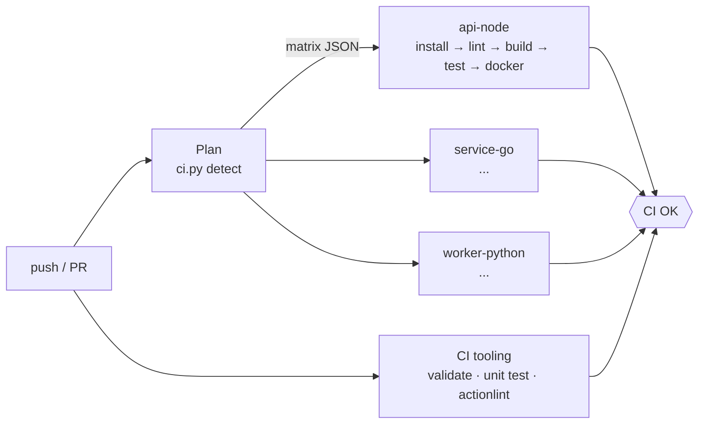

# monorepo-ci

Một repo chứa **nhiều dự án** (Node, Go, Python, thư viện dùng chung…) với pipeline CI/CD
trên GitHub Actions. Mỗi lần push hoặc mở PR, pipeline **chỉ build và test những dự án bị
ảnh hưởng**, chạy song song, rồi gom kết quả vào một check duy nhất để dùng cho branch protection.



## Cấu trúc

```
.github/
  workflows/ci.yml              # entry: plan → matrix → gate
  workflows/_project.yml        # pipeline tái sử dụng cho MỘT dự án
  actions/setup-toolchain/      # cài Node/Python/Go + cache theo lockfile của dự án
  dependabot.yml  CODEOWNERS  pull_request_template.md
ci/
  ci.py                         # driver duy nhất: list | validate | detect | run
  tests/                        # unit test cho chính logic CI
libs/py-common/                 # thư viện dùng chung
projects/
  api-node/                     # Node 22, node:test, Docker
  service-go/                   # Go, go vet/gofmt/race test, Docker distroless
  worker-python/                # Python, ruff + pytest, depends_on libs/py-common
Makefile  .githooks/pre-push
```

## Thêm một dự án mới (3 bước)

1. Tạo thư mục dưới `projects/` (hoặc `libs/`).
2. Thêm file `project.yaml`, chỉ khai báo những gì **khác** mặc định:

   ```yaml
   type: node            # node | python | go | custom
   version: "22"         # tùy chọn; Go mặc định đọc từ go.mod
   docker: true          # build Dockerfile cạnh file này (push GHCR khi merge vào main)
   depends_on:           # dự án/thư viện mà nó phụ thuộc → đổi lib là build lại dự án này
     - libs/py-common
   commands:             # ghi đè từng stage; null = tắt stage đó
     test: npm run test:ci
     build: null
   ```
3. `make validate && make ci P=projects/<tên>` rồi push. **Không cần sửa workflow nào.**

Lệnh mặc định theo `type` (xem `TOOLCHAINS` trong `ci/ci.py`):

| type   | install                   | lint                                 | build                   | test |
|--------|---------------------------|--------------------------------------|-------------------------|------|
| node   | `npm ci`                  | `npm run lint --if-present`          | `npm run build --if-present` | `npm test` |
| python | `pip install -e ".[dev]"` | `ruff check` + `ruff format --check` | `compileall src`        | `pytest` |
| go     | `go mod download`         | `go vet` + `gofmt -l`                | `go build ./...`        | `go test -race -cover` |
| custom | –                         | –                                    | –                       | bắt buộc tự khai báo |

Dự án ghi file JUnit/coverage vào `reports/` thì CI tự upload thành artifact `reports-<tên>`.

## Quy tắc chọn dự án cần build

| Thay đổi                                                    | Kết quả |
|-------------------------------------------------------------|---------|
| File trong `projects/x/`                                     | build `x` |
| File trong `libs/y/`                                         | build `y` **và mọi dự án `depends_on` nó (bắc cầu)** |
| `.github/workflows/**`, `.github/actions/**`, `ci/**`        | build **tất cả** (pipeline đổi thì phải kiểm tra lại hết) |
| `*.md`, `docs/**`, CODEOWNERS, dependabot…                   | không build gì (gate vẫn xanh) |
| Không xác định được base (lịch nightly, chạy tay, force-push, nhánh mới) | build **tất cả** — luôn fail-safe về phía build nhiều hơn |

Base để so sánh: PR → commit của nhánh đích; push → commit trước đó; merge queue → `base_sha`.

## Chạy local y hệt CI

```bash
make help                          # danh sách lệnh
make list                          # các dự án và phụ thuộc
make affected                      # dự án bị ảnh hưởng so với origin/main
make ci P=api-node                 # chạy full pipeline 1 dự án
make ci P=service-go STAGES=lint,test
make ci-affected                   # chỉ những gì nhánh của bạn đụng tới
make hooks                         # cài pre-push: lint+test dự án bị ảnh hưởng trước khi push
```

Yêu cầu: Python 3.11+ với `pip install -r ci/requirements.txt`, cộng toolchain của dự án bạn chạy.
Dự án Python nên chạy trong virtualenv.

## Thiết lập trên GitHub (làm một lần)

1. **Branch protection** cho `main`: Settings → Branches → *Require status checks* → chỉ chọn **`CI OK`**.
   Tên các job matrix thay đổi theo dự án, nên không require từng job — gate `CI OK` đã gom lại.
2. **Packages**: image được đẩy lên `ghcr.io/<owner>/<repo>/<dự án>` khi merge vào `main`
   (tag `sha-xxxxxxx`, `main`, `latest`). PR chỉ build để kiểm tra, không push.
3. Sửa `.github/CODEOWNERS` cho đúng team/người thật.
4. (Khuyến nghị) Bật *merge queue* — workflow đã hỗ trợ sự kiện `merge_group`.

## Các quyết định thiết kế

- **Một driver cho cả local và CI** (`ci/ci.py`): không có logic ngôn ngữ nào nằm rải rác trong YAML,
  nên "chạy được trên máy tôi" nghĩa là chạy được trên CI. Driver có unit test riêng.
- **Plan một lần, thực thi "ngu"**: job `plan` resolve mọi thứ (lệnh, version, docker) thành matrix JSON;
  `_project.yml` chỉ việc chạy. Thêm ngôn ngữ = thêm một entry trong `TOOLCHAINS` + một bước trong `setup-toolchain`.
- **Một check gate duy nhất** (`CI OK`, `if: always()`): PR chỉ sửa docs vẫn mergeable, job nào fail/cancel là chặn.
- **`fail-fast: false`**: một dự án hỏng không che mất trạng thái của các dự án khác.
- **Bảo mật**: `permissions: contents: read` mặc định, `packages: write` chỉ cấp cho job cần;
  lệnh được truyền qua biến môi trường rồi `eval`, không nội suy `${{ }}` vào script (chống script injection);
  có `timeout-minutes` ở mọi job; image runtime chạy non-root (distroless / user `node`).
- **Cache tách theo dự án**: cache dependency theo lockfile của từng dự án, cache Docker layer theo `scope=<tên>`
  để các dự án không đẩy cache của nhau ra.
- **Concurrency**: push mới lên PR hủy run cũ; run trên `main` luôn chạy hết.
- **Nightly full build** (02:00 giờ VN) bắt lỗi do dependency/base image trôi mà không ai đụng code.
- **Image chỉ build sau khi test xanh** (`docker` needs `build-test`).

## Khi repo lớn hơn

- Pin action theo commit SHA thay vì `@v4` (Dependabot vẫn cập nhật được) — bắt buộc nếu có yêu cầu compliance.
- Thêm bước quét bảo mật: Trivy cho image, CodeQL, gitleaks; ký image bằng cosign + SBOM.
- Thêm workflow CD: deploy theo môi trường (`environment: staging/production` với required reviewers)
  dựa trên image tag `sha-…` đã build ở đây — build một lần, promote nhiều nơi.
- Trên ~50 dự án hoặc build chậm: cân nhắc self-hosted runner (ARC trên Kubernetes) hoặc chuyển sang
  Nx / Turborepo / Bazel để có remote cache. Cấu trúc `project.yaml` hiện tại map khá thẳng sang các công cụ đó.
